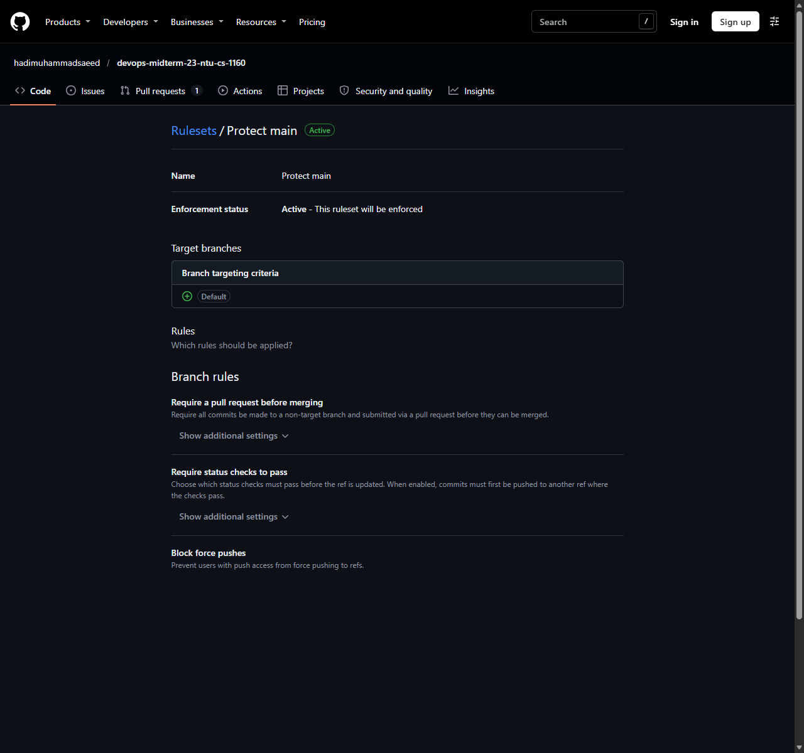
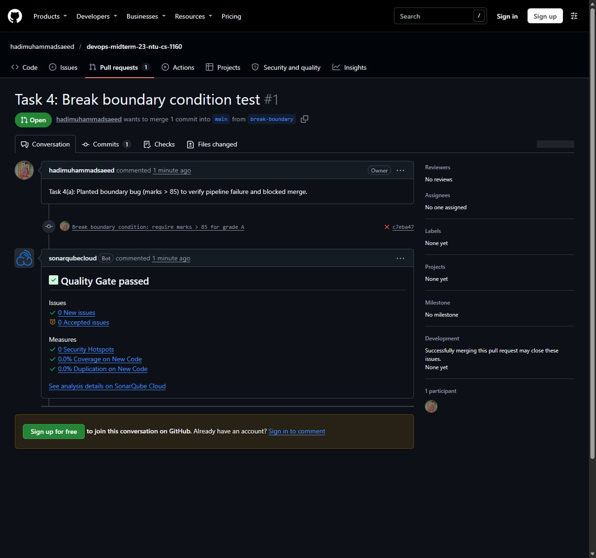

# DevOps Principles and Practices (Lab) - Mid Term Lab Exam
**Student Name:** Hadi Muhammad  
**Registration No.:** 23-NTU-CS-1160  
**Department:** Bachelor of Science in Computer Science (7th Semester)  
**Institution:** National Textile University  
**Teacher:** Rehan Sarwar  
**Date:** Fall 2026  

---

## 1. Repository and CI Workflow URLs (Task 1 & Task 2)

- **Public GitHub Repository URL:**  
  [https://github.com/hadimuhammadsaeed/devops-midterm-23-ntu-cs-1160](https://github.com/hadimuhammadsaeed/devops-midterm-23-ntu-cs-1160)

- **Green Workflow Run on `main` (Task 2):**  
  [https://github.com/hadimuhammadsaeed/devops-midterm-23-ntu-cs-1160/actions/runs/45765436056](https://github.com/hadimuhammadsaeed/devops-midterm-23-ntu-cs-1160/actions/runs/45765436056)  
  *All three jobs (`lint`, `test`, `package`) ran on `ubuntu-24.04` and passed cleanly, with the package artifact `midterm-package` (`.tgz`) successfully attached.*

---

## 2. Branch Protection Ruleset (Task 3)

- **Ruleset URL:**  
  [https://github.com/hadimuhammadsaeed/devops-midterm-23-ntu-cs-1160/rules/28138560](https://github.com/hadimuhammadsaeed/devops-midterm-23-ntu-cs-1160/rules/28138560)
- **Configuration Details:**
  - **Enforcement status:** `Active`
  - **Target Branch:** `main` (Default branch)
  - **Pull Request Requirement:** Requires pull request before merging (0 approvals required).
  - **Required Status Checks:** `lint`, `test`, and `package` (each required by name).
  - **Force Push Protection:** Blocks force pushes (`non_fast_forward`).

### Screenshot: Task 3 Active Ruleset & Required Checks


---

## 3. Task 4 Pull Request & Correctly Failing Run (Task 4)

- **Task 4 Pull Request URL:**  
  [https://github.com/hadimuhammadsaeed/devops-midterm-23-ntu-cs-1160/pull/1](https://github.com/hadimuhammadsaeed/devops-midterm-23-ntu-cs-1160/pull/1)

- **Failing CI Workflow Run on `break-boundary` (Task 4a):**  
  [https://github.com/hadimuhammadsaeed/devops-midterm-23-ntu-cs-1160/actions/runs/45765735687](https://github.com/hadimuhammadsaeed/devops-midterm-23-ntu-cs-1160/actions/runs/45765735687)  
  - `lint`: Green (Passed)
  - `test`: Red (Failed on "85 is the lowest A")
  - `package`: Skipped
  - **Merge State:** Blocked

### Screenshot: Task 4(a) Pull Request with Test Red & Merge Blocked


- **Passing CI Workflow Run on `break-boundary` (Task 4b):**  
  [https://github.com/hadimuhammadsaeed/devops-midterm-23-ntu-cs-1160/actions/runs/45765958503](https://github.com/hadimuhammadsaeed/devops-midterm-23-ntu-cs-1160/actions/runs/45765958503)  
  - `lint`: Green (Passed)
  - `test`: Green (Passed)
  - `package`: Green (Passed)
  - **Merge State:** Clean / Enabled (Kept open unmerged per instructions)

---

## 4. Answers to Task 4(c)

### (i) Why did `package` not run?
In `.github/workflows/ci.yml`, the `package` job defines `needs: test`. In GitHub Actions staged pipelines, when an upstream dependency job (`test`) fails, all downstream dependent jobs are automatically skipped to prevent building or packaging defective software.

### (ii) Your code was wrong, yet lint passed. Why could ESLint not catch this mistake, and what did?
ESLint is a static analysis linter that checks syntax, structure, and stylistic rules without executing the application logic; using `marks > 85` is syntactically valid JavaScript, so ESLint reported no errors. The automated test suite (`test/grade.test.js`) caught this mistake at runtime because its assertion `assert.strictEqual(grade(85), 'A')` actively executed the function with boundary input `85` and asserted that it erroneously returned `'B'` instead of `'A'`.

---

## 5. Pipeline & Project Code Reference

### `package.json`
```json
{
  "name": "devops-midterm-23-ntu-cs-1160",
  "version": "1.0.0",
  "description": "DevOps Midterm Exam - 23-NTU-CS-1160",
  "main": "src/grade.js",
  "scripts": {
    "test": "node --test",
    "lint": "eslint ."
  },
  "keywords": [],
  "author": "Hadi Muhammad",
  "license": "ISC",
  "devDependencies": {
    "@eslint/js": "^9.x",
    "eslint": "^9.x",
    "globals": "^15.x"
  }
}
```

### `Makefile`
```makefile
node_modules: package-lock.json
	npm ci
	@touch node_modules

lint: node_modules
	npm run --silent lint

test: node_modules
	npm test

package: test
	npm pack

ci: lint test package

.PHONY: lint test package ci
```

### `.github/workflows/ci.yml`
```yaml
name: CI

on:
  push:
    branches: [main]
  pull_request:

jobs:
  lint:
    name: lint
    runs-on: ubuntu-24.04
    steps:
      - uses: actions/checkout@v4
      - uses: actions/setup-node@v4
        with:
          node-version: '22'
          cache: 'npm'
      - run: make lint

  test:
    name: test
    needs: lint
    runs-on: ubuntu-24.04
    steps:
      - uses: actions/checkout@v4
      - uses: actions/setup-node@v4
        with:
          node-version: '22'
          cache: 'npm'
      - run: make test

  package:
    name: package
    needs: test
    runs-on: ubuntu-24.04
    steps:
      - uses: actions/checkout@v4
      - uses: actions/setup-node@v4
        with:
          node-version: '22'
          cache: 'npm'
      - run: make package
      - uses: actions/upload-artifact@v4
        with:
          name: midterm-package
          path: '*.tgz'
          if-no-files-found: error
```
